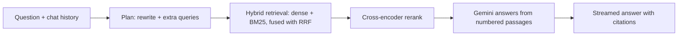

# Marginalia: Citation-Grounded Research Paper Assistant

Upload research PDFs, ask questions across all of them, compare papers side by side, and **measure** how good
the retrieval is. Every answer is written only from retrieved passages and links back to the exact PDF page.

Built as an advanced RAG system: hybrid search, reranking, query rewriting, section-aware chunking, and a built-in
evaluation lab. Not a simple "chat with a PDF" wrapper.

## Screenshots

| Ask (answers with citations) | Library (structured analysis) |
|---|---|
|  |  |

| Compare papers | Evaluate retrieval |
|---|---|
|  |  |

## Features

- **Multi-PDF library.** PyMuPDF parsing, header/footer removal, de-hyphenation, section detection (abstract,
  methods, results, ...), and metadata extraction (title, authors, year, keywords).
- **Advanced RAG chat (streamed).** Follow-up question rewriting, multi-query expansion, hybrid search
  (dense + BM25 fused with Reciprocal Rank Fusion), cross-encoder reranking, and paper/section filters.
- **Clickable citations.** Each `[n]` in an answer jumps to the passage and opens the PDF at that page.
- **Structured analysis.** Problem, contributions, methodology, datasets, metrics, key results, limitations,
  future work, extracted per paper.
- **Paper comparison.** A table over any aspects you choose, with every cell grounded in retrieved passages.
- **Evaluation lab.** Generates a test set from your own papers, then compares four retrieval methods
  (Hit rate @k, MRR, latency) with optional LLM-as-judge scores (faithfulness, relevance, correctness).

## How a question is answered



The pipeline is a LangGraph graph (`backend/app/pipeline.py`). Planning (rewrite, intent, alternative queries) is
a single structured LLM call, which keeps the app usable on free-tier rate limits.

## Evaluation results

<!-- TODO: replace with your own numbers from the Evaluate tab -->
Test set: N questions generated from M papers, k = 5.

| Method | Hit rate @5 | MRR @10 | Avg time |
|---|---|---|---|
| Semantic only | __ % | __ | __ ms |
| Keyword (BM25) only | __ % | __ | __ ms |
| Hybrid (RRF) | __ % | __ | __ ms |
| Hybrid + rerank | __ % | __ | __ ms |

LLM-judged (1 to 5): faithfulness __, relevance __, correctness __.

## Tech stack

| Layer | Tools |
|---|---|
| Backend | Python, FastAPI, Pydantic, SQLite |
| RAG | LangGraph, ChromaDB, rank-bm25, sentence-transformers (cross-encoder) |
| Models | Google Gemini (LLM + embeddings) |
| PDF | PyMuPDF |
| Frontend | React, Vite, react-markdown |

## Getting started

Requirements: Python 3.10 to 3.12 (3.13 can fail to install numpy without a C++ compiler), Node 18+, and a free
Gemini API key from <https://aistudio.google.com/apikey>.

```bash
# 1) Backend
cd backend
python -m venv .venv
.venv\Scripts\activate            # Mac/Linux: source .venv/bin/activate
pip install -r requirements.txt
copy .env.example .env            # Mac/Linux: cp .env.example .env, then add GOOGLE_API_KEY
uvicorn app.main:app --reload --reload-dir app --port 8000

# 2) Frontend (new terminal)
cd frontend
npm install
npm run dev                       # open http://localhost:5173
```

The first start downloads the reranker model (about 90 MB). Set `RERANKER=none` in `.env` to skip it.

### Configuration (`backend/.env`)

| Variable | Default | Purpose |
|---|---|---|
| `GOOGLE_API_KEY` | none | Gemini API key |
| `LLM_MODEL` | `gemini-3.5-flash` | Chat model id |
| `EMBEDDING_MODEL` | `gemini-embedding-2` | Embedding model id |
| `RERANKER` | `cross-encoder` | `cross-encoder` or `none` |
| `RERANKER_MODEL` | `cross-encoder/ms-marco-MiniLM-L-6-v2` | Hugging Face reranker |
| `DATA_DIR` | `backend/data` | Where PDFs, SQLite and Chroma are stored |

Model ids change over time. If you get a 404, check the current ids in Google AI Studio.
If you change `EMBEDDING_MODEL` after indexing, delete `backend/data/chroma` and re-upload your papers.

## Project structure

```
backend/app/
  ingestion.py    PDF parsing, section detection, chunking, metadata
  store.py        Chroma, BM25, Reciprocal Rank Fusion, reranker
  pipeline.py     LangGraph RAG pipeline and answer generation
  analysis.py     structured paper analysis and comparison
  evaluation.py   test-set generation, retrieval ablation, LLM judge
  api.py          REST and Server-Sent Events routes
frontend/src/     React app (Ask, Library, Compare, Evaluate)
```

## Design decisions

- **Hybrid search.** Dense search finds paraphrases, BM25 finds exact terms like model names and metrics.
  Reciprocal Rank Fusion merges them without tuning score scales.
- **Section-aware chunking.** Chunks never cross section boundaries, and each stores its section and page, so
  answers can be filtered and cited precisely. References are not indexed.
- **Contextual embeddings.** Each chunk is embedded with its paper title and section as a header, while the
  stored text stays clean for display.
- **Measure, don't guess.** The Evaluate tab tests every retrieval upgrade on your own papers.

## Limitations and roadmap

- Scanned (image-only) PDFs are not supported, since there is no OCR.
- Evaluation questions come from single passages, so multi-hop questions are not covered.
- Planned: OCR fallback, table and figure extraction, a research-gap finder agent, and Docker deployment.

## Privacy

Papers are stored locally in `backend/data`. Text is sent to the Gemini API for embeddings and answers, and
free-tier usage may be used by Google to improve its models. Do not upload confidential documents on the free tier.

## Author

**Sohail Ahmad**, BS Computer Science, Islamia College University Peshawar.
[GitHub](https://github.com/Sohail-ahmad-ux) · [LinkedIn](https://linkedin.com/in/sohail-ahmad-ab9aa6341)

## License

MIT. See [LICENSE](LICENSE).
